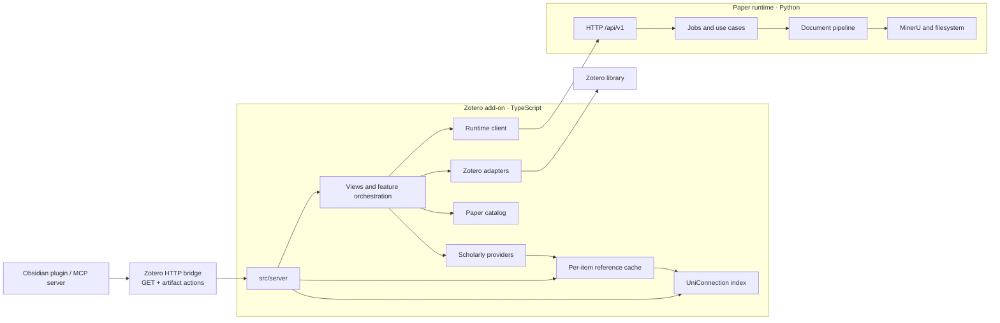

# Architecture

## System

**Main path:** Obsidian plugin / MCP server → localhost bridge on Zotero’s HTTP server →
add-on data plane (cache, derived relations, conversion) → Zotero items / scholarly
providers / paper runtime.

Metadata and literature relations run in the add-on. PDF/EPUB conversion, artifact
publishing, and Markdown annotation injection require the local runtime.

**Shared link parser.** `packages/links` (`@unizero/links`) holds the `unizero://` grammar,
Markdown / Canvas link scanning, evidence units and link roles. The Obsidian plugin and
the add-on both link it as a local file dependency and bundle it, so they agree on what
counts as one mention; it carries no host APIs and no Node built-ins. The MCP server does
not scan notes and does not use it yet.

## Add-on layers

| Layer | Current paths | Role |
| --- | --- | --- |
| Lifecycle | `src/hooks.ts`, `src/core/` | Register and clean up features per window |
| Features | `src/features/` | Conversion and annotation command orchestration |
| Bridge | `src/server/` | Endpoints for Obsidian and the MCP server; see [Bridge contract](#bridge-contract) |
| UI | `src/ui/` | Menus, panel, Uniconnection (`unizeroHome.ts`) |
| Dialog content | `addon/chrome/content/` | Privileged XHTML/JS: `panel`, `preferences` |
| Zotero adapters | `src/zotero/` | Read and mutate Zotero items, attachments, and excerpt notes |
| Providers | `src/modules/*Api.ts`, `src/modules/resolve.ts` | Scholarly HTTP access and normalization |
| Cache | `src/modules/localStorage.ts`, `src/modules/literatureCache.ts` | Per-item shards under the add-on data directory |
| Derived index | `src/modules/uniConnection.ts`, `src/modules/uniConnectionSync.ts` | Reverse-reference index, excerpts, and coupling |
| Paper links | `src/modules/paperLinkIndex.ts`, `src/zotero/paperLinkSources.ts` | Paper-to-paper mentions read from Raw / Canvas files with `packages/links` |
| Catalog | `src/projects/` | Paper catalog schemas and local object persistence |
| Runtime boundary | `src/runtime-client/` | Contract types, HTTP, launch, process state |

`src/modules/` holds the established relations data plane (`views.ts`), metadata, provider, and cache code. New
code uses the specific directories above; split existing modules only when a change needs
that seam.

Feature IDs statically registered in `src/core/features.ts`: `literature.relations`
(derived index, Uniconnection tab and item menu, preferences),
`library.metadata`, `document.convert`, `annotations`, and `obsidian.bridge`.

## Bridge contract

Neither the Obsidian plugin nor the MCP server holds a second bibliographic store. Both
call `/unizero/v1/*` on Zotero’s loopback HTTP server (`BRIDGE_API_VERSION = 2` in
`apps/zotero-addon/src/server/bridgePayloads.ts`). This boundary is unrelated to the
add-on ↔ runtime `/api/v1` contract.

Invariants:

- **Mostly read-only and non-destructive.** GET endpoints never mutate Zotero or the
  catalog. POST endpoints act only on a paper's own conversion or Raw/Canvas attachments
  and never erase files or write arbitrary content. The one exception, `POST
  /vault-mentions`, replaces the plugin's derived snapshot of Vault links in the add-on's
  own cache and touches no Zotero item. Bibliographic edits and exploration import
  require a separate contract.
- **Capability-announced evolution.** Compatible endpoints, parameters, and fields are
  advertised in `GET /ping` `capabilities` (`templates`, `canvas`, `trash`, `restore-raw`,
  `subcollections`, `artifacts`, `markdown-attachments`, `link-sources`, `link-targets`,
  `excerpts`, `vault-mentions`) while keeping `BRIDGE_API_VERSION` at 2.
- **Add-on owns attachment rules.** Consumers discover PDFs, `unizero:<kind>` artifacts,
  and linkable Markdown/Canvas files through the bridge rather than inspecting Zotero tags
  or storage directories. Raw and ordinary Markdown/Canvas attachments qualify as linkable
  documents; Raw Backup, generated exports, and foreign files do not.
- **No unbidden network or process startup.** `GET /relations` answers from cache
  (`loaded: false` on a miss) unless explicit `fetch=1` is passed; `GET /templates`
  reports `available: false` rather than starting a stopped runtime. Rendering a note
  never triggers provider calls or conversion.
- **Durable identity.** Persisted links use `libraryID` + `itemKey`. Citekeys are aliases;
  ambiguity is reported, never resolved silently.

| Endpoint | Key behavior |
| --- | --- |
| `GET /ping` | `api` version, `capabilities`, and `ready` state |
| `GET /paper`, `GET /suggest` | Item metadata and attachment links by `libraryID`+`itemKey` or citekey; free-text search |
| `GET /collections`, `GET /collection-items` | Libraries, collections, and papers (`subcollections=1` includes descendant collections) |
| `GET /artifacts` | Paper PDFs, `unizero:<kind>` artifacts (with source PDF), and linkable `markdowns` |
| `GET /link-sources` | Paged snapshot (`scan`, `offset`, `limit`) of linkable Zotero documents; expired scan returns 409, incomplete scan never prunes |
| `GET /link-target` | Parent-scoped attachment resolution; missing explicit `attachment` returns 404 without fallback |
| `GET /relations` | Cached `references`, `citations`, or `relation` (`fetch=1` queries providers); includes user `excerpts` even when `loaded: false` |
| `GET /templates` | Templates of an already-running runtime (`available: false` when stopped) |
| `POST /convert` | Starts conversion with `conversion.defaultTemplate` or optional `template`; trashes and replaces a Raw whose file is missing |
| `POST /canvas` | Returns `unizero:canvas`, creating an empty `.canvas` first if absent; accepts no file body |
| `POST /trash`, `POST /restore-raw` | Moves `kind=raw\|canvas` to Zotero trash; copies Raw Backup into a new Raw and trashes the old one |
| `POST /vault-mentions` | JSON body: one Vault's full snapshot of paper links in its notes (`vaultID`, `vaultName`, `mentions`); replaces that Vault's previous snapshot; a malformed body is rejected whole (400) |

The Obsidian application layer maintains its own rebuildable document-link index fed by
Vault events and opt-in Zotero `/link-sources` scans. Vault targets use logical `vaultID`
+ UID (paths are derived); editing a local attachment happens directly in Obsidian and
never writes back to the relation cache or Paper catalog. Zotero cannot read the Vault,
so the plugin (`src/vaultMentionSync.ts`, setting **Show Vault notes in Zotero**) posts
the paper links in Vault notes to `POST /vault-mentions` after its index settles, and
only when they changed.

## Paper catalog

Stored under `<dataDir>/unizero/literature/` (`src/projects/paperCatalog.ts`). Every
Zotero-initiated References or Citations snapshot load materializes results as stable
Paper documents (retention climbing `cache → pinned → zotero`, converged by DOI / arXiv /
S2 / OpenAlex aliases or query-scoped fingerprints) along with
`LiteratureCitationObservation` records; unreferenced `cache` Papers are garbage-collected
after snapshot replacement. Since the legacy Home Board was removed, nothing in the add-on
reads the catalog back.

## Derived relations index

`UniConnection` (`src/modules/uniConnection.ts`) is memory-only and rebuildable from
per-item `References-Resolved-v4` cache shards, item identifiers, and child notes tagged
`unizero:excerpts`. One reverse index serves the References / Citations lists,
bibliographic coupling (`relation`), Uniconnection's Bibliography, and the bridge:

- **Stable edge keys only.** `edgeIdentity` yields `doi:` / `arxiv:` / `s2:`; rows without
  one are skipped rather than keyed by title.
- **No Zotero display fields.** Stores scoped item keys and edge keys (plus excerpt text
  snapshots); `views.ts` / UI models enrich display metadata at query time.
- **All edges indexed; library filtering happens at query time.**
- **Direct shard reads on bulk build**, bypassing the 32-entry resident cache LRU.
- **Incremental maintenance.** `uniConnectionSync` observes item and excerpt-note changes;
  a References refresh awaits shard write + `ingestItem` before resolving.
- **Same-library item-to-item excerpts.** Excerpt sections pointing into the same library
  count in `relationsOf` even without a provider edge; cross-library links are ignored.

Design constraints: [UNICONNECTION.md §5](UNICONNECTION.md#5-书目反向索引与文献耦合).

## Runtime boundary

The add-on calls `/api/v1` (`packages/contracts/http/v1.schema.json`, mirrored in
TypeScript and Pydantic); neither process reaches into the other's internals. Runtime
layers (`api/`, `application/`, `pipeline/`, `providers/`, `composition.py`) keep all
mutable state under a single runtime home resolved by `paths.py`. On each side the
boundary code stays thin: the add-on's `src/runtime-client/` holds transport concerns
only, never document-processing logic, and the runtime's `api/` handlers validate and map
requests while `application/` services orchestrate.

During conversion, `transform.content` extracts ordered bibliography records from MinerU's
full content list before stripping the Markdown bibliography; the add-on stores those
records in the `ZoMiner References` (`unizero:references`) JSON attachment and owns all
provider matching and library resolution.

## Data ownership

| Data | Owner |
| --- | --- |
| Bibliographic fields, item relations, PDF annotations | Zotero items and attachments |
| Citation excerpts (passages of A attached to cited paper B) | A's child note tagged `unizero:excerpts` (written only by `src/zotero/excerptNotes.ts`) |
| Provider responses | Per-item cache shards under the add-on data directory |
| Reverse-reference index and coupling | Derived in memory from reference shards and excerpt notes |
| Paper links in Vault notes, for Uniconnection | Obsidian plugin's Vault index; Zotero keeps the last snapshot per Vault in `<dataDir>/unizero/vault-mentions.json` (derived cache) |
| Stable external/library paper records | Paper catalog (`<dataDir>/unizero/literature/`, currently write-only) |
| Conversion templates, jobs, and work files | Paper runtime and runtime home |
| Published vault Markdown and `uid` frontmatter | User-selected filesystem destination (runtime supplies default `uid`) |
| Converted paper text in Zotero | Imported Markdown `unizero:raw` (user-edited, never overwritten) + `unizero:raw-backup` (replaced per conversion) |
| Extracted PDF bibliography | `ZoMiner References` JSON attachment (`unizero:references`) |
| Zotero item ↔ Obsidian URL binding | Per-library JSON outside the item shard tree (preserves user-edited `obsidian://` URLs across reconversion) |
| Generated attachment identity | `unizero:<kind>` tags (never display titles) |

Exact add-on paths: [Stored state](../apps/zotero-addon/README.md#stored-state).

## Host surface: Uniconnection

- **Uniconnection** (`src/ui/unizeroHome.ts`, `Zotero_Tabs.add` type `unizeroHome` — the
  internal type keeps its name, and has no `-` because Zotero splits tab types on
  hyphens): a main-window tab of paper-to-paper relations. On open and reload it refreshes
  the memory-only paper-link index (`src/zotero/paperLinkSources.ts`): every Raw / Canvas
  attachment is listed through `listLinkSources`, checked by size and modification time,
  and only changed files are read and parsed with `packages/links`. Annotation activity
  comes from one SQL aggregate (`src/zotero/uniConnectionActivity.ts`). The paper page's
  Bibliography reads provider caches through `views.ts` and fetches only on a click;
  `ensureCanvasAttachment` on `+ Canvas` is the tab's only write. Citations also lists
  the Vault notes from the plugin's snapshots (`src/zotero/vaultMentionStore.ts`, which
  reloads open tabs when one arrives) by name only; clicking one opens the note at its
  first mention through `obsidian://unizero?vault=…&vaultID=…&file=…&line=…&node=…`. A
  mention's Canvas button opens the paper's Zotero Canvas at the card through
  `obsidian://unizero?libraryID=…&itemKey=…&canvas=…&node=…`, which carries only Zotero
  identity; the plugin finds the file through `/artifacts`. Because Zotero aborts
  startup tab restoration on an unregistered tab type, each window's
  `Zotero_Tabs.getState` is wrapped to omit the tab from saved sessions, and all wrappers,
  hooks, toolbar buttons, menu entries and tabs are cleaned up on window unload and
  shutdown; the index is cleared on shutdown.

The item-pane References / Citations section and the UniConnection full window were
retired with this tab ([UNICONNECTION.md §4.1](UNICONNECTION.md#41-zotero-uniconnection-标签页)).

UI behavior and constraints: [UNICONNECTION.md §4](UNICONNECTION.md#4-界面与宿主边界). Unfinished
work lives in [ROADMAP.md](ROADMAP.md).
